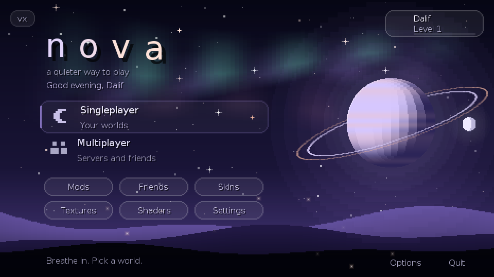
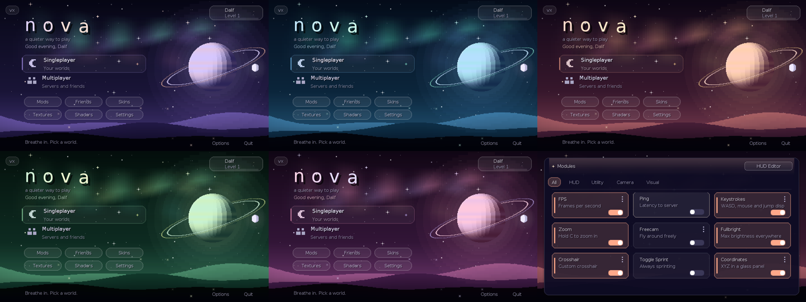
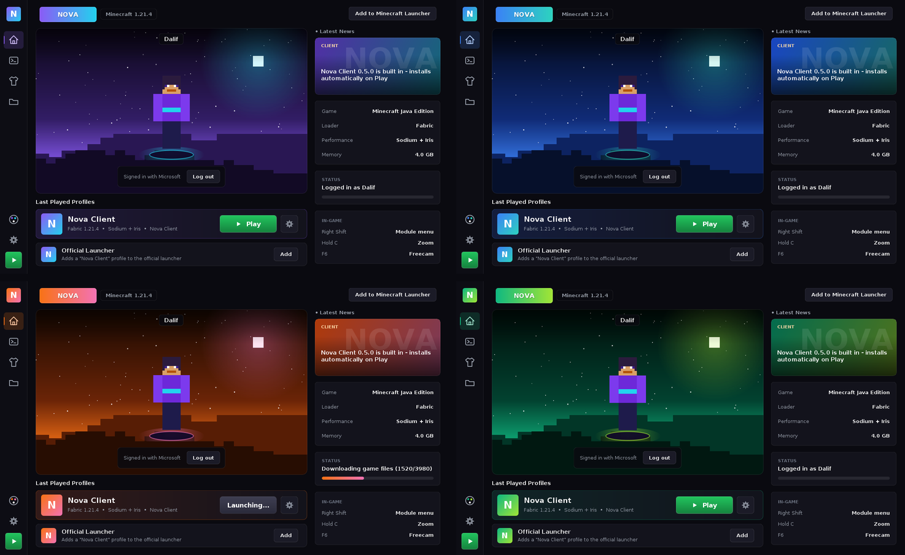
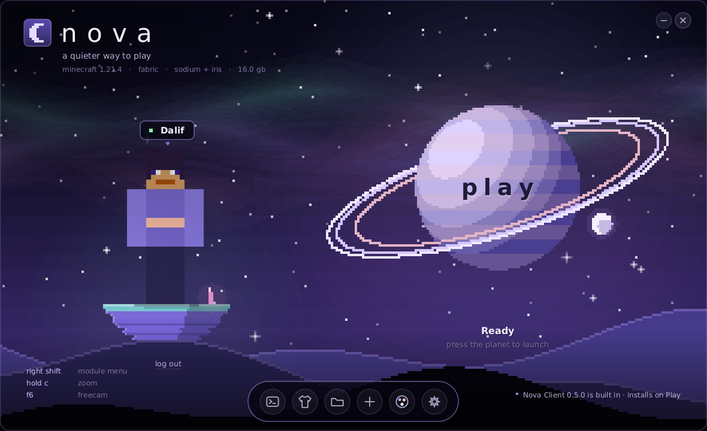

# Nova (client + launcher)

```
Nova/
  NovaClient/     the Fabric mod (menu, freecam, accounts, skins, friends, modules...)
  NovaLauncher/   the desktop app that installs Minecraft + Fabric + Nova and starts it
  NovaLauncher.jar   ready-to-run launcher (needs Java 21+)
  .github/        auto-release pipeline
```


## What is new in v3 (Nova Serenity, client 0.6.0)

The in-game client has a new identity: calm, soft and a little out of this world. Nothing flashes, everything eases.



- **A living night sky behind every screen**: slow aurora curtains, twinkling stars, three layers of hills with mist,
  drifting fireflies and a shooting star every 17 seconds. Mouse parallax moves the layers gently.
- **The hub**: a quiet left column (logo, two big "doors" for Singleplayer / Multiplayer, six small pills, your saved
  servers under "Jump back in") in front of a slowly turning ringed planet with an orbiting moon. A time-aware
  greeting and soft tips ("Breathe in. Pick a world.") replace the old tile grid.
- **Truly rounded glass** everywhere (`Ui.rrect`, `Ui.panel`) instead of cut corners, with hairline rims and soft shadows.
- **Module menu**: a floating frosted panel, a pill that glides under the active tab, pill switches, rounded sliders.
- **HUD**: every panel is frosted glass with a thin line of light along the top edge (`module/Hud.java`).
- **Toasts** drift down and a thin line slowly drains instead of a bar.
- **5 calm palettes** (Twilight, Lagoon, Dusk, Meadow, Blossom). Same indexes 0-4 as before, so the launcher's
  `-Dnova.theme` still lines up. Change it in game: Right Shift > Visual > Theme.



New building blocks if you want to extend it: `gui/Cosmos.java` (the sky and the planet), `Ui.rrect / rim / panel / glow /
sparkle / bar`, `AnimButton.Style.ROW` and `PILL`, and `Anim.breathe / smooth / easeInOutSine`.
Colours live in `gui/Theme.java` (accent, deep accent, warm secondary, two sky colours, three aurora colours).

Note: the scene is drawn with plain GUI fills (a few thousand rectangles per frame). It is fine on normal PCs; on a very weak
machine you can lower the aurora cost by raising `step` in `Cosmos.aurora`.

## What is new in v2 (Nova Aurora design)

**Launcher**: rebuilt UI with a sidebar, a hero card (your skin on an animated night scene), profile rows with a big Play button, a status column, a Console page and a dark Settings window with a memory slider. Login / install / update logic is unchanged.

**5 colour themes** (Nova, Ocean, Sunset, Emerald, Rose): click the palette button in the launcher sidebar. The choice is saved and passed to the game (`-Dnova.theme`), so the in-game menu, HUD panels and module list use the same colours. You can also change it in the game: Right Shift > Visual > Theme.



**New modules (Right Shift menu)**

| Module | Tab | What it does |
|---|---|---|
| Fullbright | Visual | Max brightness everywhere. Restores your old brightness when off or on exit. |
| Crosshair | Visual | Custom crosshair: size, gap, thickness, colour, centre dot. Replaces the vanilla one. |
| Low Fire | Visual | Fire overlay no longer covers your view (adjustable). |
| Theme | Visual | Palette 0-4 for the whole client. |
| Speed | HUD | Blocks per second. |
| Memory | HUD | RAM used / max. |
| Combo | HUD | Hits in a row, resets when you get hit or after 3 s. |
| Module List | HUD | Shows which features are on, with accent bars. |

HUD panels (Potion Status, Armor Status, Coordinates) use titled glass panels. Shared look lives in `module/Hud.java` (`Hud.titled(...)`). New HUD modules are off by default so your layout does not change; turn them on in the menu and place them with the HUD editor.



## One app: launcher + client together (Windows)
1. Install the JDK once: `winget install EclipseAdoptium.Temurin.21.JDK` (then reopen the window).
2. Double-click **build-everything.bat**. It builds the Nova Client mod and packs it INSIDE the launcher,
   then makes a standalone **NovaLauncher.exe**. Everything ends up in the `dist` folder.
3. Run `dist\NovaLauncher\NovaLauncher.exe`. Two ways to play:
   - **PLAY**: installs Nova Client + Fabric API + Fabric + Minecraft and starts the game (Microsoft login
     needs your Azure client ID in Settings; otherwise it starts offline).
   - **Add to Minecraft Launcher**: adds a "Nova Client" profile to the official launcher in one click.
     The official launcher handles your Microsoft login, so no Azure app is needed.
   Updates: a new build of the launcher carries the new mod; with an update URL set, the launcher can also
   fetch a newer mod by itself (it only downloads when the online version is newer than the built-in one).

## What is in the client (0.4)
- **Animated hub**: shimmering logo, parallax background with floating particles, big Play buttons,
  icon tiles, quick-join for your saved servers, tips, and a profile pill (top right).
- **Profile**: your skin on a glowing platform, Nova level + XP bar, playtime, sessions, friends, modules.
- **Module menu** (Right Shift): search, tabs, animated cards, per-module settings (sliders).
- **HUD editor**: drag elements anywhere (edges and centre snap), scroll over one to resize.
- **HUD**: FPS, Ping, CPS, Coordinates, Direction, Clock, Keystrokes (animated), Armor, Potion Status.
- **Camera**: Zoom (hold C, adjustable level) and Freecam (F6, adjustable speed).
- **Toasts** slide in for toggles, logins, updates. Custom wallpaper with slow zoom + mouse parallax.

## Quick start (no GitHub needed)
1. Build the mod: open `NovaClient/` in IntelliJ (or `gradle build`) -> `build/libs/novaclient-0.6.0.jar`
2. Run the launcher: `java -jar NovaLauncher.jar`
3. Settings -> "Local Nova jar" -> pick that jar -> **PLAY**.
   The launcher downloads Minecraft, Fabric, Fabric API (newest), copies your jar in, and starts the game.
   Not logged in = offline mode (singleplayer / offline servers only).

## Automatic updates (the "always newest" part)
1. Put this folder in a GitHub repo.
2. In the launcher Settings set **Update manifest URL** to
   `https://github.com/YOU/REPO/releases/latest/download/latest.json`
3. To ship a new version: `git tag v0.6.1 && git push --tags`.
   GitHub Actions builds everything and publishes `latest.json`.
4. Every player's launcher sees it on the next PLAY: it downloads the new Nova jar (checksum verified),
   removes the old one, refreshes Fabric API, and starts. The in-game menu also shows an "Update available" card.

What updates by itself: Nova, Fabric API, Fabric Loader, Minecraft files, even the Java runtime.
What needs you once per Minecraft release: bump `minecraft_version`, `yarn_mappings`, `fabric_version`,
`sodium_version`, `iris_version` in `NovaClient/gradle.properties`, fix any code that Mojang renamed, then tag.
When `latest.json` says a new `minecraft` version, every launcher moves to it automatically.

## Login
Create a free Azure app (personal accounts, "Allow public client flows"), paste its client ID in
launcher Settings (and `config/novaclient.json` for in-game login). Mojang must approve new apps
before Minecraft login works. Tokens are stored in plain text in `launcher.json`: keep it private.

## Package as a real app (.exe / .app / .deb)
```
cd NovaLauncher && ./build.sh
jpackage --type exe --name "Nova Launcher" --input . --main-jar NovaLauncher.jar \
         --main-class com.nova.launcher.LauncherApp --win-shortcut --win-menu
```
Use `--type dmg` on macOS, `--type deb` on Linux (jpackage must run on the target OS).

## Licenses
Sodium: PolyForm Shield 1.0.0. Iris: LGPL-3.0. Keep their notices when distributing.
